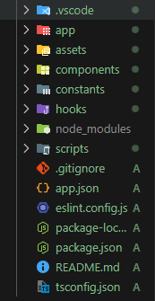
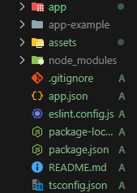
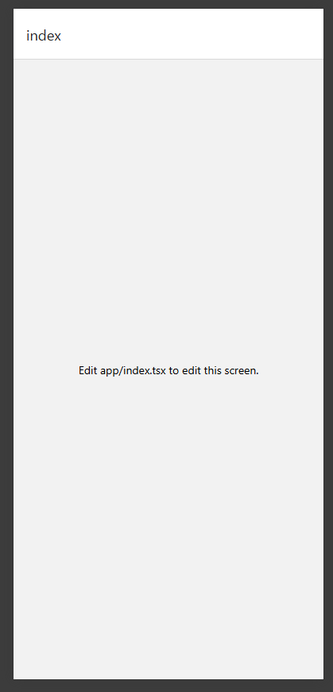
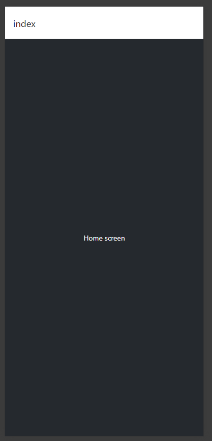
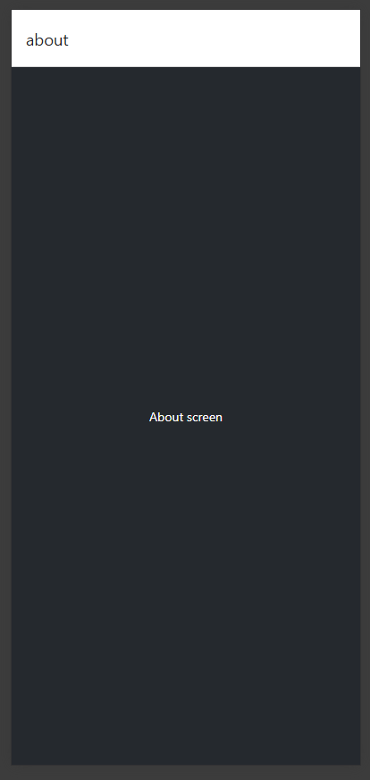
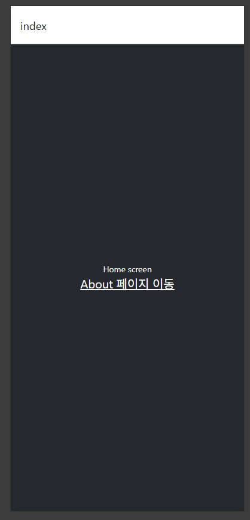
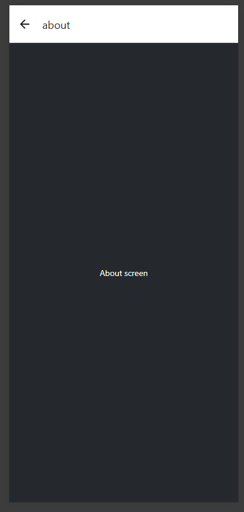
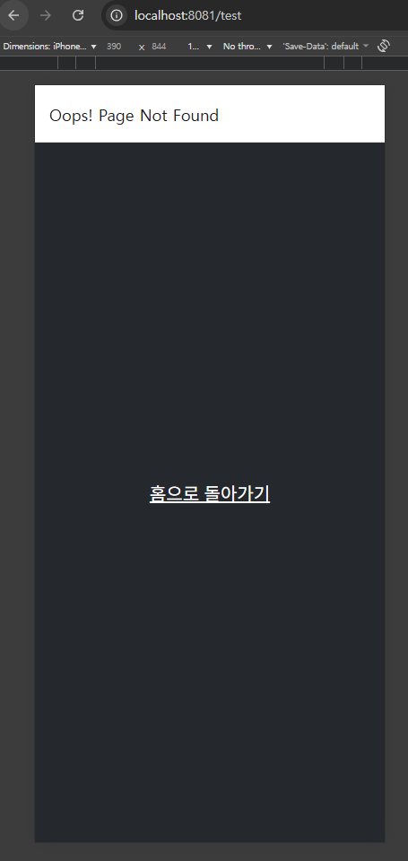
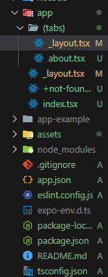
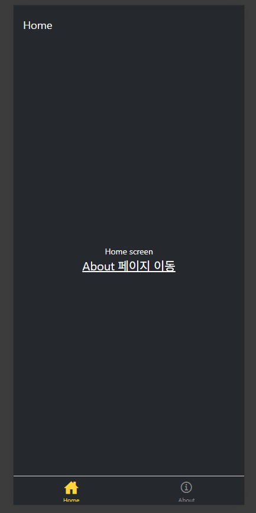

---

title: Expo 로 빠르게 React Native 크로스 플랫폼 앱 만들기 (1)
published: 2025-11-18
description: 'Expo 공식 문서로 프로젝트 생성부터 하단 바 만들면서 친해지기'
image: './expo_app_develope.png'
tags: [React Native, Expo, 오픈소스, 앱]
category: 'React Native'
draft: false
lang: 'ko'
----------

# Expo 로 빠르게 React Native 크로스 플랫폼 앱 만들기

스노우보드의 계절이 다가오면서, 이번 시즌 내내 사용할 앱을 하나 만들기 위해 여러 기술 스택을 검토해보았고

**Expo 기반 React Native** 로 개발하기로 결정 했습니다.

이 결정의 이유는 다음과 같습니다.

1. 12월 본격적인 개장 전에 MVP를 완성해야합니다.

2. 저는 Android 유저지만, 주변의 iOS 유저들과 함께하고 싶습니다.

3. 현재 회사에서 JS기반 개발을 가장 많이 사용하고 있습니다.

4. Android Studio와 Xcode 없이 빌드하고 배포하고싶습니다.

기술을 결정한 만큼, 개발 전에 Expo 공식 문서와 튜토리얼을 통해 기본 개념부터 익숙해지는 과정을 공유하려고 합니다.

>[!NOTE]

> https://docs.expo.dev/tutorial/create-your-first-app/
> 본 포스팅은 Expo 공식 튜토리얼 참고하여 작성 되었습니다.

## Expo 프로젝트 생성하기

```bash
npx create-expo-app@latest <프로젝트 명>
```

템플릿을 이용해 초기 세팅이 완료된 Expo 기반 RN 프로젝트를 생성합니다.




### 템플릿으로 프로젝트 생성할 때의 이점

- Expo 패키지와 기본적인 RN 환경이 이미 구성됨
- Expo CLI 등 권장 개발 도구가 포함되어 있음
- 기본적으로 `expo-router`가 포함된 상태로 생성됨
- Android, iOS, Web 실행 환경이 자동으로 구성됨
- TypeScript가 기본 설정됨

## Expo 프로젝트 초기화(reset-project)

```bash
cd <프로젝트 명>
npm run reset-project
```

초기 템플릿에서 불필요한 예시 파일을 정리할 수 있습니다.
`app/` 폴더의 `index.tsx`, `_layout.tsx`를 제외한 파일들이 정리됩니다.



### reset-project 동작

- 앱 디렉터리를 기본 구조로 재설정
- 예시 파일을 `app-example/` 하위로 이동하여 참고용으로 이관

## Expo 앱 실행하기
>[!TIP]

> Android 사용자는 Google Play 스토어에서 Expo Go 설치가 필요합니다.

> iOS 사용자는 기본 카메라로 QR 스캔 시 Expo Go 설치 페이지로 이동합니다.

```bash
npx expo start
```



Expo 개발 서버가 실행되며 테스트 방식은 아래와 같습니다.

1. 터미널에 QR 코드 표시
2. (앱) Android 사용자는 Expo Go 앱에서 스캔 / iOS 사용자는 기본 카메라로 QR 스캔 후 실행
3. (웹) 터미널에 표기된 URL 접속

## 기본 파일(Index) 설정하기

### `app/index.tsx` 의 역활

- 앱의 첫 번째 화면을 정의하는 엔트리 파일입니다.
- React Native의 `View`, `Text` 컴포넌트를 사용해 화면을 구성합니다.
- 스타일은 `style` prop으로 `JS 객체` 형태로 지정합니다.
  (웹과 달리 `display: flex`가 기본이며 스타일 명이 `camelCase`입니다.)
>[!TIP]

> https://reactnative.dev/docs/style React Native 스타일 지정

### 스타일 지정하기

```jsx
import { Text, View, StyleSheet } from 'react-native';

const Index = () => {
  return (
    <View style={styles.container}>
      <Text style={styles.text}>Home screen</Text>
    </View>
  );
};

export default Index;

const styles = StyleSheet.create({
  container: {
    flex: 1,
    backgroundColor: '#25292e',
    alignItems: 'center',
  },
  text: {
    color: '#fff',
  },
});
```
1. `app/index.tsx` 파일
2. `react-native`의 `StyleSheet` 객체 정의
3. `<View>` 배경 스타일 적용
4. `<Text>` 텍스트 스타일 적용



## 라우터(Router) 설정하기

`Expo Router` 는 파일 기반 라우팅을 기본으로 합니다.


### Expo Router 기본 규칙

- `app/` 디렉터리 구조가 곧 앱의 라우팅 구조가 됩니다.
  화면 컴포넌트, 레이아웃, 라우트 그룹은 모두 `app/` 하위에 배치합니다.
- `app/_layout.tsx`에 `Header` 및 `Tab Bar`와 같은 공통 UI와 네비게이션 구조를 정의합니다.
- `index.tsx` 파일은 해당 디렉터리의 인덱스(기본) 경로를 의미합니다.
  예시. `app/index.tsx` → `/`, `app/about/index.tsx` → `/about`
- Android, iOS, Web에서 동일한 경로 사용

### 화면 추가하기 (app/화면.tsx , app/화면/index.tsx)

`/home` 경로 화면 추가하기 위해 `app/home.tsx` 파일을 생성합니다.

```jsx
import { View, Text, StyleSheet } from 'react-native';

const About = () => {
  return (
    <View style={styles.container}>
      <Text style={styles.text}>About screen</Text>
    </View>
  );
};

export default About;

const styles = StyleSheet.create({
  container: {
    flex: 1,
    backgroundColor: '#25292e',
    justifyContent: 'center',
    alignItems: 'center',
  },
  text: { color: '#fff' },
});
```



### 화면 이동(Link)

`expo-router`의 `Link` 컴포넌트를 사용하여 화면을 이동합니다.

```jsx
import { Link } from 'expo-router';
import { Text, View, StyleSheet } from 'react-native';

const Index = () => {
  return (
    <View style={styles.container}>
      <Text style={styles.text}>Home screen</Text>
      <Link href="/about" style={styles.button}>
        About 페이지 이동
      </Link>
    </View>
  );
};

export default Index;

const styles = StyleSheet.create({
  container: {
    flex: 1,
    backgroundColor: '#25292e',
    alignItems: 'center',
    justifyContent: 'center',
  },
  text: {
    color: '#fff',
  },
  button: {
    fontSize: 20,
    textDecorationLine: 'underline',
    color: '#fff',
  },
});
```

화면 컴포넌트 내부에 `<Link>` 컴포넌트 추가



> ![TIP]
> `Lick`를 통해 이동한 화면 상단에는 자동으로 뒤로가기 버튼이 생성됩니다. 



### 404 Not found(app/+not-found.tsx)

존재하지 않는 경로로 접근 시 보여줄 대체 화면 화면을 추가합니다.

1. `app/+not-found.tsx` 생성
2. (선택)`Stack.Screen`의 `options`으로 제목 설정
3. (선택)리다이렉션 경로 추가

```jsx
import { Link, Stack } from 'expo-router';
import { View, StyleSheet } from 'react-native';

const NotFoundScreen = () => {
  return (
    <>
      <Stack.Screen options={{ title: 'Oops! Page Not Found' }} />
      <View style={styles.container}>
        <Link href="/(tabs)" style={styles.button}>
          홈으로 돌아가기
        </Link>
      </View>
    </>
  );
};

export default NotFoundScreen;

const styles = StyleSheet.create({
  container: {
    flex: 1,
    backgroundColor: '#25292e',
    justifyContent: 'center',
    alignItems: 'center',
  },

  button: {
    fontSize: 20,
    textDecorationLine: 'underline',
    color: '#fff',
  },
});
```

>[!TIP]

> 탭 네비게이션을 사용하기 전에는 href="/" 로 이동해도 되고,
> 탭 구조를 도입한 뒤에는 href="/(tabs)" 로 홈을 처리하는 패턴이 더 안전합니다.
> 아래 예시는 탭 구조를 고려한 형태입니다.



### 하단 바 (app/(tabs)/\_layout.tsx)

`app/(tabs)` 디렉터리를 통해 하단 바를 추가하고, 탭에 포함되는 화면들을 그룹화 할 수 있습니다.

```jsx title="app/(tabs)/_layout.tsx"
import { Tabs } from 'expo-router';

const TabLayout = () => {
  return (
    <Tabs>
      <Tabs.Screen name="index" options={{ title: 'Home' }} />
      <Tabs.Screen name="about" options={{ title: 'About' }} />
    </Tabs>
  );
};

export default TabLayout;
```

```jsx title="app/_layout.tsx"
import { Stack } from 'expo-router';

const RootLayout = () => {
  return (
    <Stack>
      <Stack.Screen name="(tabs)" options={{ headerShown: false }} />
    </Stack>
  );
};

export default RootLayout;
```
1. `app/(tabs)/_layout.tsx` 탭 레이아웃 정의
2. `app/_layout.tsx` 루트 레이아웃에 `(tabs)` 경로 추가
3. `app/(tabs)` 생성 및 하위에 메뉴바에 포함되는 경로(컴포넌트) 이동
4. `app/+not-found.tsx`에서 홈 경로를 `"/(tabs)"` 로 업데이트



### 경로 제목 설정(Tab / Stack 옵션)

각 화면의 제목이나 옵션은 `app/_layout.tsx`에 내 `Tabs.Screen` 또는 `Stack.Screen`의 `options`을ㄹ 통해 설정합니다.

```jsx
<Tabs>
  <Tabs.Screen name="index" options={{ title: 'Home' }} />
  <Tabs.Screen name="about" options={{ title: 'About' }} />
</Tabs>
```
>[!TIP]

> Stack 이란?
> 여러 화면 사이를 탐색할 때 사용하는 네비게이션 스택입니다.
> Android: 새 화면이 위로 슬라이드되는 애니메이션
> iOS: 새 화면이 오른쪽에서 슬라이드되는 애니메이션
> `expo-router`는 새로운 경로를 푸시(push)할 때 내부적으로 `Stack`을 사용해 화면 이동을 관리합니다.

#### 하단 바 스타일링

`app/(tabs)/_layout.tsx` 에서 탭 바 스타일을 지정 할 수 있습니다.

```bash
npm i @expo/vector-icons
```

```jsx
import { Tabs } from 'expo-router';
import Ionicons from '@expo/vector-icons/Ionicons';

const TabLayout = () => {
  return (
    <Tabs
      screenOptions={{
        tabBarActiveTintColor: '#ffd33d',
        headerStyle: { backgroundColor: '#25292e' },
        headerShadowVisible: false,
        headerTintColor: '#fff',
        tabBarStyle: { backgroundColor: '#25292e' },
      }}
    >
      <Tabs.Screen
        name="index"
        options={{
          title: 'Home',
          tabBarIcon: ({ color, focused }) => (
            <Ionicons name={focused ? 'home-sharp' : 'home-outline'} color={color} size={24} />
          ),
        }}
      />
      <Tabs.Screen
        name="about"
        options={{
          title: 'About',
          tabBarIcon: ({ color, focused }) => (
            <Ionicons name={focused ? 'information-circle' : 'information-circle-outline'} color={color} size={24} />
          ),
        }}
      />
    </Tabs>
  );
};

export default TabLayout;
```


1. `@expo/vector-icons` 설치

2. `(tabs)/_layout.tsx` 에서 `<Tabs>` 컴포넌트에 `screenOptions` 옵션으로 공통 스타일 지정

3. 각 `<Tabs.Screen>` 의 `options.tabBarIcon` 에 아이콘 컴포넌트 설정



> 다음 글로 계속됩니다.