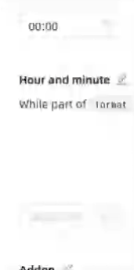
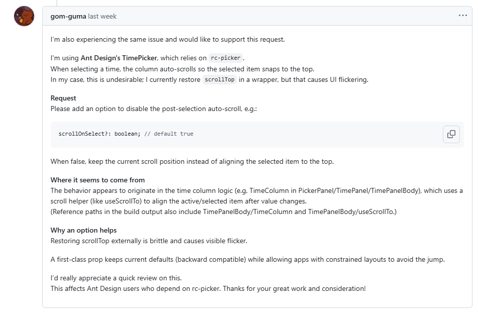

---

title: Ant Design TimePicker 이벤트 컨트롤하기
published: 2025-11-17
description: 'TimePicker 컴포넌트 커스텀으로 타이밍 제어 본질 파헤치기'
image: './antd_timepicker_custom.png'
tags: [React, UX, 오픈소스]
category: 'React'
draft: false
lang: 'ko'
----------

# antd TimePicker 자동 스크롤 억제

setTimeout vs requestAnimationFrame 타이밍 제어의 본질 파헤치기

---

## 1. 사용자의 동작 개선 요청

사내 프로젝트에서 antd TimePicker를 사용하던 중, 타 개발팀과 QA로부터 유사한 UX 관련 이슈가 올라왔습니다.

> "특정 정책에서 시간을 선택했을 때, 갑자기 스크롤 위치가 위로 이동힙니다. 개선 요청 드립니다."

실제로 TimePicker는 리스트를 스크롤하며 탐색하고 있다가 특정 항목을 클릭하는 순간, 스크롤이 **강제로 상단 방향으로 이동**합니다.



개발자 입장에서 보면 “선택된 값으로 정렬해 주는 자연스러운 동작”처럼 느껴질 수 있지만,
실제 사용자는 화면이 부드럽게 이어지는 것이 아니라, **리스트가 위로 확 밀려 올라가는 듯한 이질감**을 경험하고 있었습니다.

> 실제 저는 개발 당시 이 동작을 너무나도 자연스럽게 생각했기 때문에 문제가 뭔지 3초 정도의 시간이 필요했습니다.

이 컴포넌트는 여러 페이지에서 다수 사용되고 있고, 한 화면에서 시·분·초를 반복해서 조정하는 시나리오도 많았습니다.
따라서 이 동작을 방치하면 특정 정책 화면뿐 아니라 서비스 전반의 사용성에 영향을 줄 수 있다고 판단했습니다.

이 글에서는 프로젝트에서 사용 중인 Ant Design TimePicker의 기본 동작을 그대로 두지 않고,
실제 서비스 환경에 맞게 **자동 스크롤을 제어하는 Wrapper 컴포넌트**를 어떻게 구성했는지 정리합니다.

---

## 2. 내부 구현 살펴보기 — 자동 스크롤이 발생하는 진짜 이유

문제를 정확히 해결하려면 내부 동작을 먼저 이해해야 합니다.

우선 antd TimePicker의 구조와 핵심 구현체인 **rc-picker** 내부를 살펴봤습니다.

### 2.1 antd TimePicker의 실제 핵심: rc-picker

> [!NOTE]
> [https://ant.design/components/time-picker](https://ant.design/components/time-picker) Ant Design TimePicker 컴포넌트

antd의 DatePicker/TimePicker는 대부분 rc-picker를 감싼 래퍼에 가깝습니다.
실제 렌더링과 상호작용 로직은 rc-picker에서 결정됩니다.

### 2.2 TimePanel의 자동 스크롤 로직

> [!NOTE]
> [https://github.com/react-component/picker/blob/master/src/PickerPanel/TimePanel/TimePanelBody/useScrollTo.ts](https://github.com/react-component/picker/blob/master/src/PickerPanel/TimePanel/TimePanelBody/useScrollTo.ts) rc-picker TimePanel의 스크롤 Hooks

rc-picker TimePanel은 선택된 항목이 항상 사용자 시야에 들어오도록 다음과 같은 로직을 사용합니다.

```ts
scrollTo({ index: selectedIndex, behavior: 'smooth' });
```

항목이 선택되면 해당 인덱스 위치로 스크롤을 맞춰 주는 방식입니다.
문제는 이 동작을 **끄거나 커스터마이징할 수 있는 공식 옵션이 없다는 점**입니다.

### 2.3 setTimeout이나 CSS만으로 해결되지 않는 이유

항목 선택 시 내부 흐름을 단순화하면 다음과 같습니다.

```
React 이벤트 처리
→ rc-picker state 업데이트
→ TimePanel 재렌더링
→ 내부 scrollTo 실행
→ 브라우저 Layout / Paint
```

우리가 원하는 지점은 **자동 스크롤이 모두 끝난 뒤** 기존 `scrollTop`을 복원하는 것입니다.
이 동작은 스타일 레벨에서 제어할 수 없고, `setTimeout`만으로도 렌더링 타이밍을 정확히 맞추기 어렵습니다.

---

## 3. 문제 해결 전략 — setTimeout 대신 requestAnimationFrame을 선택한 이유

자동 스크롤을 완전히 제거하기보다는, 자동 스크롤이 끝난 시점에 **기존 scrollTop을 되돌리는 방식**이 현실적이라고 판단했습니다.
핵심은 "언제" 복원하느냐입니다.

### 3.1 setTimeout 접근의 한계

가장 먼저 시도한 방식은 다음과 같습니다.

```js
setTimeout(() => {
  col.scrollTop = prev;
}, 0);
```

하지만 실제 UI에서는 다음과 같은 문제가 드러납니다.

* `setTimeout`은 이벤트 루프 기반으로 동작합니다.
* 브라우저 렌더링 프레임과 직접적으로 동기화되지 않습니다.
* 하드웨어 성능, CPU 로드, 탭 활성 상태 등에 따라 실행 타이밍이 흔들립니다.
* 결과적으로 UI에서 **1~3px 정도의 미세한 흔들림**이 눈에 띄게 발생합니다.

즉, 타이밍 제어 관점에서 `setTimeout`은 “언젠가 실행된다” 이상을 보장해 주지 않기 때문에, 반복 입력이 많은 컴포넌트에는 적합하지 않았습니다.

### 3.2 requestAnimationFrame의 장점

`requestAnimationFrame`(rAF)은 브라우저의 **다음 렌더링 직전**에 콜백을 실행합니다.
이 특성을 이용해 다음과 같이 구현했습니다.

```js
requestAnimationFrame(() => {
  requestAnimationFrame(() => {
    col.scrollTop = prev;
  });
});
```

이 패턴이 상대적으로 안정적인 이유는 다음과 같습니다.

1. 첫 번째 rAF: rc-picker의 `scrollTo` 호출이 실제 DOM에 반영된 이후 시점입니다.
2. 두 번째 rAF: Layout/Composite까지 마무리된 다음 프레임입니다.

이 타이밍에 `scrollTop`을 복원하면, 사용자는 리스트가 한번에 제자리로 정리되는 것처럼 인식하게 됩니다.

아래 예시는 실제로 사용한 rAF 유틸 함수의 형태입니다.

```ts
export const runAfterReflow = (fn: () => void) => {
  requestAnimationFrame(() => {
    requestAnimationFrame(() => {
      fn();
    });
  });
};
```

이 유틸을 사용하면 다음과 같이 의도를 드러내면서도 코드 양을 줄일 수 있습니다.

```ts
runAfterReflow(() => {
  col.scrollTop = prev;
});
```

### 3.3 Wrapper 컴포넌트로 구현

rc-picker 내부를 직접 수정하는 것은 유지보수 비용이 너무 크기 때문에,
antd에서 제공하는 `panelRender` 옵션을 활용해 패널을 감싸는 **Wrapper 컴포넌트**를 구성했습니다.

핵심 흐름은 다음과 같습니다.

1. `panelRender`를 통해 TimePanel DOM을 감싸고, 내부 컬럼 엘리먼트에 대한 ref를 수집합니다.
2. 항목 클릭 직전에 각 컬럼의 `scrollTop`을 snapshot으로 저장합니다.
3. `onChange`가 호출되는 시점에 `runAfterReflow`(rAF × 2)를 사용해 `scrollTop`을 기존 값으로 복원합니다.
4. 복원 직후 짧은 시간(예: 50~150ms) 동안 wheel 이벤트를 일시 차단합니다.

실제 코드는 대략 다음과 같은 형태가 됩니다.

```tsx
const CustomTimePicker: React.FC<TimePickerProps> = (props) => {
  const columnsRef = useRef<HTMLDivElement[]>([]);
  const scrollSnapshot = useRef<number[]>([]);

  const panelRender = (originPanel: React.ReactNode) => (
    <div
      className="custom-time-panel-wrapper"
      onMouseDown={() => {
        scrollSnapshot.current = columnsRef.current.map((col) => col.scrollTop);
      }}
    >
      {originPanel}
    </div>
  );

  const handleChange = (value: Dayjs | null) => {
    props.onChange?.(value);

    runAfterReflow(() => {
      columnsRef.current.forEach((col, index) => {
        col.scrollTop = scrollSnapshot.current[index] ?? col.scrollTop;
      });
    });
  };

  return (
    <TimePicker
      {...props}
      onChange={handleChange}
      panelRender={panelRender}
    />
  );
};
```

위 예시는 개념을 보여주기 위한 코드이며,
실제 프로젝트에서는 DOM 선택, wheel 차단, 다국어/포맷 처리 등을 포함해 더 많은 로직이 들어가 있습니다.

---

## 4. 구현 후 고려해야 할 사항들 (버전 호환성, 이벤트 흐름, 스크롤 제약 등)

### 4.1 rc-picker DOM 구조 의존성

내부 클래스(`.ant-picker-time-panel-column`)나 DOM 구조는 라이브러리 버전업에 따라 변경될 수 있습니다.

따라서 rc-picker 또는 antd 버전 업데이트 시에는 간단한 e2e 테스트나 Storybook 상호작용 테스트를 통해

* 스크롤 복원이 정상적으로 동작하는지
* 컬럼 참조가 깨지지 않았는지

를 함께 확인하는 것이 안전합니다.

### 4.2 panelRender 지원 버전 확인

antd 버전에 따라 `panelRender`의 제공 여부나 시그니처가 다를 수 있습니다.
사용 중인 버전의 문서를 한 번 더 확인하고,
최소 한두 개의 실제 화면을 기준으로 동작을 검증한 뒤 공통 컴포넌트로 승격하는 편이 좋습니다.

### 4.3 wheel 이벤트로 인한 위치 튐 방지

스크롤 복원 직후 사용자가 즉시 wheel 스크롤을 입력하는 경우,
다시 위치가 흔들리는 문제가 발생할 수 있습니다.

실제 서비스에서는 **복원 이후 50~150ms 정도** wheel 이벤트를 일시적으로 막았을 때 가장 자연스러운 결과를 얻을 수 있었습니다.
단, 이 값은 브라우저와 디바이스에 따라 느낌이 달라질 수 있어, 환경별로 튜닝 가능하도록 상수로 분리했습니다.

```ts
const WHEEL_BLOCK_MS = 100;
```
---

## 5. 관련된 rc-picker Issue — 옵션 추가 요청 현황

> [https://github.com/react-component/picker/issues/937](https://github.com/react-component/picker/issues/937)

2025년 8월, rc-picker GitHub 저장소에는 TimePanel 자동 스크롤을 제어할 수 있는 옵션을 추가해 달라는 이슈가 등록되었습니다.

이 이슈를 확인한 뒤, 실제 서비스에서 겪은 사례를 바탕으로 다음과 같은 요구사항을 댓글로 남겼습니다.



* `autoScrollToSelected: boolean` 형태의 비활성화 옵션이 필요함
* 항목 선택 시 내부 `scrollTo` 호출을 막을 수 있어야 함
* 패널 전체를 직접 커스터마이징하는 방식은 유지보수 비용이 크므로, 옵션 기반 제어가 현실적임
* 자동 스크롤이 UX를 해치고 있는 실제 서비스 사례와 캡처를 함께 공유함

rc-picker 차원에서 옵션이 제공된다면, 현재처럼 DOM 구조에 의존해 스크롤을 되돌리는 방식 대신
**공식 API를 통한 제어**가 가능해집니다. 장기적으로는 이 방향이 더 안전합니다.

---

## 6. 완전한 해결이 어려웠던 부분 — 미세한 "덜컹임"의 한계

rAF × 2 패턴으로 스크롤 복원 타이밍을 조정하면서, 눈에 띄는 튐 현상은 상당 부분 완화할 수 있었습니다.

다만 구조적인 제약으로 인해 **한 프레임 수준의 짧은 덜컹임**을 완전히 제거하는 것은 어렵습니다.

### 6.1 scrollTo는 즉시 Layout 스케줄링을 발생시킨다

`scrollTo`가 호출되는 순간 다음과 같은 일이 일어납니다.

* 대상 DOM의 `scrollTop` 값이 즉시 변경되고
* 브라우저가 레이아웃 계산을 스케줄링하며
* 첫 번째 Layout 단계에서 화면에 반영됩니다.

우리가 rAF에서 복원 코드를 실행하는 시점은 이미 이 Layout 이후입니다.
결국 **전혀 움직이지 않은 것처럼 보이게 만드는 것**은 불가능하고,
"움직이긴 하지만 사용자에게 거의 보이지 않을 정도로 줄여 두는 것"이 현실적인 목표가 됩니다.

### 6.2 Storybook을 통한 UX 검토 및 최종 합의

커스텀 TimePicker는 Storybook에 별도의 스토리로 분리해, 디자이너와 QA와 함께 실제 UX를 검토했습니다.

비교는 주로 다음 세 가지 케이스를 기준으로 진행했습니다.

* **기본 동작 (자동 스크롤 그대로)**
  → 리스트가 위로 밀려 올라가는 느낌이 강하고, 반복 입력 시 피로도가 큼
* **`setTimeout` 기반 복원**
  → 튐 현상이 여전히 눈에 띄고, 환경에 따라 흔들림 정도가 달라짐
* **rAF × 2 기반 복원**
  → 아주 미세한 흔들림은 남아 있지만, 실제 업무 사용 흐름에서는 거의 체감되지 않는 수준

결과적으로 다음과 같이 합의했습니다.

> "미세한 덜컹임을 완전히 없앨 수는 없지만,
> 기본 동작에 비해 UX가 충분히 개선되었고,
> 실제 서비스 시나리오에서도 문제 없이 사용할 수 있다."

이에 따라 해당 패턴을 사내 공통 TimePicker 래퍼 컴포넌트에 반영하고,
다른 프로젝트에서도 재사용할 수 있도록 공통 UI 레이어에 정리했습니다.
Storybook에는 개선 전/후 동작을 비교할 수 있는 스냅샷과 GIF를 함께 남겨 두었습니다.

---

## 7. 마무리하며 — 타이밍 제어가 프런트엔드에서 중요한 이유

프런트엔드 UI 이슈를 다루다 보면, 다음과 같은 패턴을 자주 보게 됩니다.

> 많은 UI 문제는 "무엇을 할 것인가"(로직)의 문제가 아니라,
> "언제 할 것인가"(타이밍)의 문제입니다.

이번 TimePicker 개선 작업도 마찬가지였습니다.

React 이벤트 루프, rc-picker의 렌더링 사이클, 브라우저의 layout/paint 단계,
`scrollTo`의 동작 방식, `requestAnimationFrame`의 호출 타이밍을 함께 놓고 봤을 때야
비로소 문제의 원인과 해결 방향이 명확해졌습니다.

`setTimeout`과 `requestAnimationFrame`의 차이는 단순히 "조금 더 빠르다/느리다"의 문제가 아니라,
**시간 기반 제어 vs 프레임 기반 제어**라는 관점의 차이에 가깝습니다.

TimePicker 자동 스크롤 제어는 언뜻 보기에는 작은 기능 개선처럼 보이지만,
브라우저 렌더링 메커니즘과 UI 타이밍 제어를 다시 정리해 볼 수 있었던 사례였습니다.

> UI는 "시간"으로 움직이지 않습니다. UI는 "프레임"으로 움직입니다.

비슷한 이슈를 겪고 있는 분들께, 이 글에서 정리한 타이밍 제어 전략과 Wrapper 구성 방식이
하나의 참고 자료가 되기를 바랍니다.